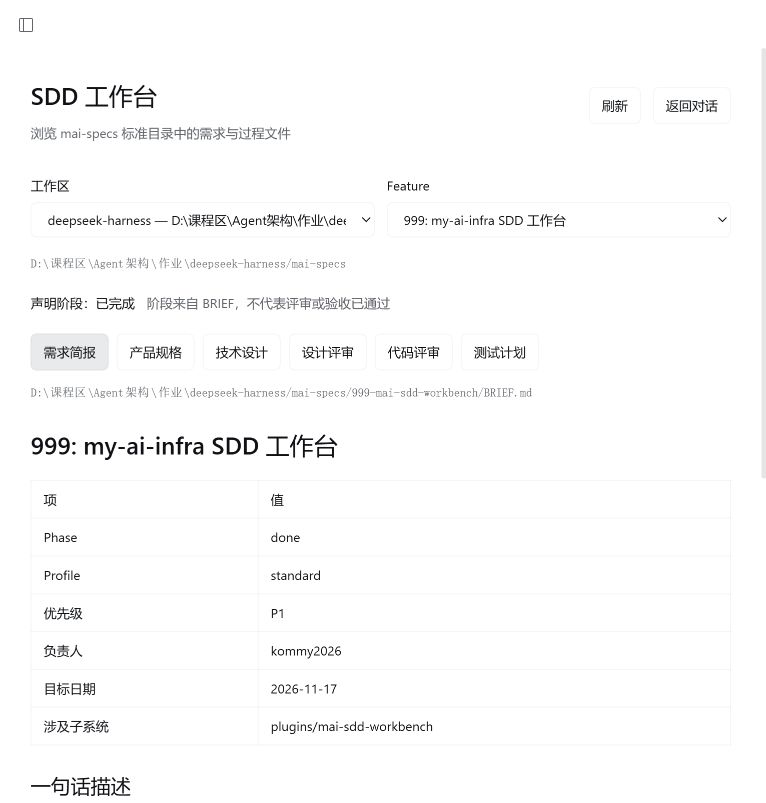

# 对照课件完成这份作业

这是面向首次开发 DSH 插件的操作教程。课程与作业依据见 [素材索引](_INDEX.md)，本次功能和验收条件见 [产品规格](../spec/PRD.md)。作业允许选取工作台的一个小能力，因此本版聚焦“找 Feature、读文档、手动刷新”。

## 第一步：Fork 并启动原项目

Fork 是把原项目复制到自己的 GitHub 账号；clone 是把它放到本机。先成功启动原项目，才能区分环境问题和自己写的插件问题。这对应作业的环境准备要求。

本机已准备 Node 24.22.3、pnpm 11.28.5、Git 和原项目依赖，并完成原项目构建。DSH 当前源码要求 Node 24.9+；课件中 my-ai-infra 的最低要求不能代替 DSH 自己的要求。常规开发终端中的顺序是：

```sh
pnpm install
pnpm run build
pnpm dsh web
```

此时应能看到 DSH 页面。工作台阅读文档不调用模型，因此不需要先购买或配置模型 API key。重新启动和插件安装说明见 [插件指南](../../../plugins/mai-sdd-workbench/README.zh.md)。

## 第二步：初始化 my-ai-infra

作业给出的入口是：

```sh
npm install --global @easyuseai/my-ai-infra
mai init
mai doctor
```

my-ai-infra 提供一组约束 AI 工作方式的 Skill。init 把这些工作流接入仓库，doctor 检查文件和入口是否能被发现。本机已经初始化，doctor 返回 healthy=true、issues=[]。这只说明基础设施可用，插件功能还要另行开发和验收。

对应课件第 36 页：把架构、规则和项目背景准备为编码上下文。原 DSH 规则保存在 `.agents/rules/AGENTS.md`，没有用作业模板覆盖原项目约束。

## 第三步：先写清楚需求

本次建立 [Feature 999](../BRIEF.md)，把一个需求及其过程材料放在同一目录。PRD 是“要做什么、怎样算完成”的唯一依据，维护 AC-01～AC-06；设计、代码和测试都引用这些编号。

你先读 [PRD 的验收表](../spec/PRD.md#6-验收标准唯一维护源)，能说清楚三个动作：在 DSH 里打开工作台，选择 Feature 阅读文档，修改磁盘文件后手动刷新。Phase 只是 BRIEF 中的声明，不能由“文件存在”推断验收通过。这对应课件第 11 页的规格、实现和证据对齐。

## 第四步：设计并评审，再写实现

[技术方案](../design/TECH_DESIGN.md) 解释“怎样做”：通过 DSH 的侧栏和主区域插槽提供页面，复用现有 workspaceFiles 读取文件；React 由 DSH 提供，Markdown 转成安全的 React 元素。

[设计评审](../review/design_review.md) 把风险变成实施条件：只能读取固定文档路径；切换时旧请求不能覆盖新选择；分页时不能混拼不同版本；中文目录必须能用。[测试计划](../test/TEST_PLAN.md) 在实现前列出验证这些行为的方法。这对应课件第 6 页的技术设计和测试上下文，以及第 39 页的评审流程。

实际实现位于 `plugins/mai-sdd-workbench`，入口、构建、文件读取和视图各有明确职责。先看 [插件文件说明](../../../plugins/mai-sdd-workbench/README.zh.md#文件说明)，再按需要读源码。

## 第五步：用自动测试和真实操作验证

自动测试负责稳定制造路径穿越、乱序响应、拒绝读取、版本变化等反例；真实 DSH 操作负责确认插件确实能安装、打开、阅读、刷新、分页、停用、启用和重启。两种证据解决不同问题。

本版 11 项开发测试通过，真实 DSH 中已读到磁盘修改后的新正文和新增 Feature；7500 行长文通过“加载更多”读到末尾；分页间文件变化时会阻止混拼。深色/英文、浅色/中文和窄窗口均已检查，用户原来的中文、跟随系统设置已恢复。逐项结果和未实测的环境分支见 [实际执行记录](../test/TEST_PLAN.md#实际执行记录2026-11-17)。这对应课件第 37、49 页对实际结果的验证要求。

## 第六步：演示与提交

你可以按下面的顺序演示：

1. 在 DSH 侧栏点击“SDD 工作台”。
2. 工作区选择 deepseek-harness，Feature 选择“999: my-ai-infra SDD 工作台”。
3. 点击“产品规格”，解释本版的功能与验收表。
4. 点击“技术设计”“设计评审”“代码评审”，说明实现方式和已处理的风险。
5. 点击“测试计划”，展示实际结果；在外部修改一份文档后点击“刷新”，展示读到新内容。
6. 点击“返回对话”，说明这是接入 DSH 的真实插件页面。



作业提交使用 [你的 Fork 作业分支](https://github.com/kommy2026/deepseek-harness/tree/feat/mai-sdd-workbench)，同时注明分支名 `feat/mai-sdd-workbench`。根 README 有作业入口，代码、依赖和安装说明、同一 Feature 下的需求/设计/评审/测试/截图均在分支中。作业并未要求发布 npm 包或向上游提 PR；课程平台的最终提交仍需按老师指定入口填写链接。
