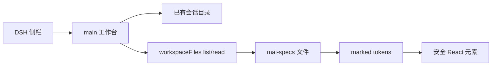

# SDD 工作台技术方案

> Profile：standard；模板：`mai-specs/_templates/TECH_DESIGN.tmpl.md`（裁剪）；有效需求：[PRD](../spec/PRD.md) AC-01～06；基线：实施前 HEAD（DSH 0.2.2-rc.3）；日期：2026-11-17；状态：设计评审条件已落实，见评审与测试记录。

[返回简报](../BRIEF.md)

## 1. 最小方案与复用

新增独立本地 bundle `plugins/mai-sdd-workbench`，不进入 `packages/*/*` 的官方包发布体系。Host 入口为无副作用的 `apply`；Client 工厂经 `window.__ModuleLoader__.load` 注册，从 DSH module table 获取 React。构建将维护中的 `marked` tokenizer 打包到浏览器产物，避免手写 Markdown 解析器，也不重复打包 React。

DSH `sidebar.panellist` 已有侧栏按钮与选中态；插件只贡献图标和 label。`main` keyed slot 承载页面，key 与侧栏 id 相同。`layout.selectPanel(null)` 返回对话。依赖的公开插槽、全局 `useSessions`、locale 和 workspaceFiles 已按所有者 README/source 核对；本环境没有 `cordis_inspect_*`，未进行运行时注册检查，安装后的页面验证补齐宿主证据。



## 2. 接口、数据与状态

页面通过标准 `useSessions` 获得 `ids/byId/cwd`；显示会话与 cwd 作为显式读取对象，不切换聊天。无会话或 cwd 时提示先创建目标工作区会话。所选会话退出目录后自动回到可用项。

注入面只包含 `loadFeatures(sessionId,cwd,signal)`、`readDocument(sessionId,cwd,feature,artifact,offset,signal)`、`back()`，组件不接收 Cordis context。复用 `workspaceFiles.list(sessionId,'mai-specs',signal)` 和 `read(sessionId,absolutePath,{offset},signal)`；成功使用 `{ok,value}`，Host 失败位于 `result.error.code`，读取适配器将它转换为组件内部的 `{ok:false,code}`。省略 limit，沿用 Host 的分页与字节上限。

Feature 目录必须为 `NNN-slug` 且为 directory，忽略 `_templates` 等辅助目录；按编号倒序。固定六类 artifact 路径与 PRD 一致。BRIEF 第一页用于抽取标题/Phase；未知或缺失显示未标注。标题和 Phase 只是文件声明，不推断阶段通过。每个 Feature 读取一次 BRIEF，单次刷新内顺序进行，不建后台轮询或跨页面缓存。

文件读取状态由组件当前请求持有：loading/ready/error；新选择或刷新会取消旧 AbortController，回调提交前检查取消状态，关闭页面也取消。切换 Feature 后清除旧正文，避免显示错误归属。分页用 offset + lines；同一文档下一页的 version 与首批不同则丢弃追加并提示刷新，避免拼接两个版本；eof=false 显示“内容尚未读完”和“加载更多”。空正文是合法文档。

### 核心代码设计（拟议伪代码，尚非实现证据）

```js
function artifactPath(cwd, feature, artifact) {
  if (!isFeatureName(feature)) throw new Error('invalid feature');
  const relative = ARTIFACTS.find(item => item.id === artifact)?.path;
  if (!relative) throw new Error('invalid artifact');
  return cwd.replace(/[/\\]+$/, '') + '/mai-specs/' + feature + '/' + relative;
}
// 每个 effect 的回调只提交仍属于当前选择的结果。
const controller = new AbortController();
readDocument(selection, controller.signal).then(result => {
  if (!controller.signal.aborted) setDocument(result);
});
// effect cleanup: controller.abort()
```

`isFeatureName` 接受三位编号和 Unicode slug，拒绝 `/`、`\`、控制字符和尾部点/空白；实际代码以目录条目及此规则双重约束，测试覆盖中文 slug。

## 3. Markdown 与 UI

使用 marked 的 lexer，tokens 转为 React 元素。支持标题、段落、列表、引用、表格、代码、行内强调；原始 HTML 以文本显示，不调用 dangerouslySetInnerHTML。外链只允许 http/https/mailto，使用新窗口及 noopener；本地相对链接显示为文本，图片仅显示替代文字，避免外部加载和任意文件读取。暂不渲染 Mermaid 或数学公式，以代码块展示。

使用独立前缀 CSS 与 `--dsw-alias-*` 主题 tokens，字重不超过 500。原生 select/button、清晰 label、focus-visible、文档按钮 aria-pressed；窄屏换行，表格和代码块滚动，整体不横向溢出。locale 字典包含 zh/en，所有产品文案经 locale 注册及绑定。自绘文档/任务图标，不使用第三方品牌标志。

## 4. 生命周期与安装

注册通过 `ctx.slots.inject` 所有权清理；字典与 teardown 通过 `ctx.effect`。卸载时仅当 activePanelId 等于本插件 key 才 selectPanel(null)。无写文件、定时器、全局 DOM 或 session event。安装使用 DSH Plugins > Add plugin 的本地目录入口；不手改 profile 清单或 patch。浏览器验证通过 dsh web 的 in-page picker overlay 启动。

发布物包含 package.json、index.js、client.js、cordis.patch.yml、locale 与 icon、README 和打包依赖的 THIRD_PARTY_NOTICES。开发源码、固定依赖、构建和测试脚本一起提交，已构建 client.js 允许课程使用者直接加载。重新构建浏览器产物后按 DSH 规则重启以载入新代码。

## 5. 实施与验证任务

| 任务 | 交付 | AC |
|---|---|---|
| T1 | bundle manifest/patch/locale/icon、构建入口 | 01、06 |
| T2 | Feature/path/BRIEF/read adapter 与行为测试 | 02、04、05 |
| T3 | 原生工作台、token renderer 与界面快照 | 01～05 |
| T4 | 实际安装、打开、读取、刷新、禁用启用及重启验证 | 01～06 |
| T5 | README 作业入口、评审与测试结果，索引同步 | 全部 |

重点风险是 Windows 中文路径、会话切换竞争、分页版本变化、受限文件读取和 UI 注册清理。自动测试验证反例；实际 DSH 页面验证行为与 light/dark、窄容器状态。无模型输入/输出和持久 Session 改动，不增加 session replay；新页面的确定性渲染样例留在插件自己的 tests 下。完整构建已在初始化阶段通过；最终再运行适用的 build:check，报告实际执行结果。
